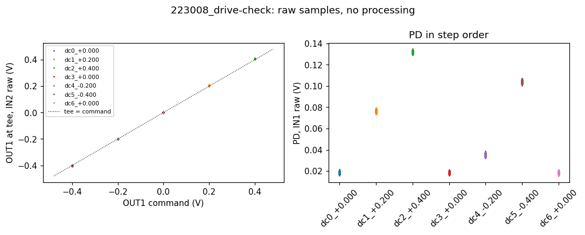
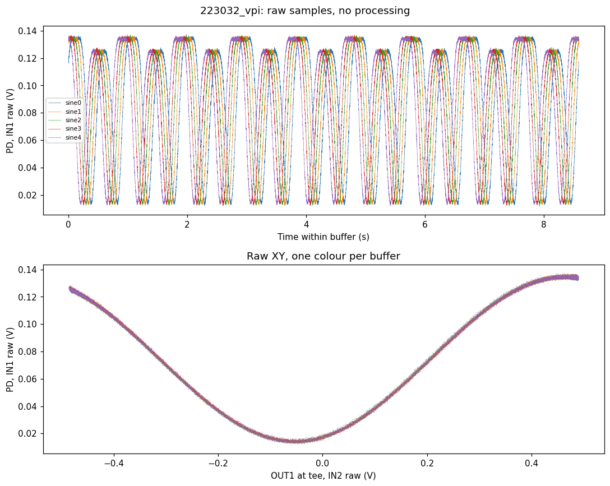
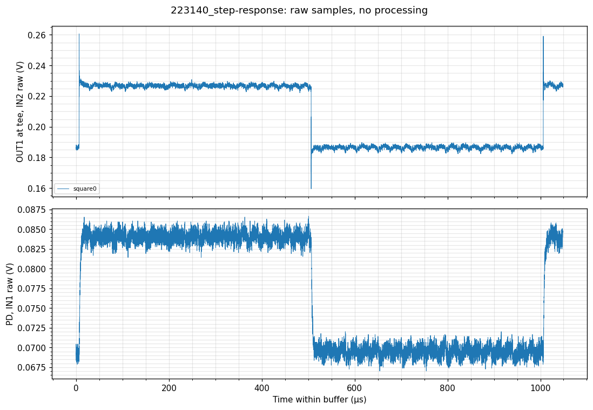
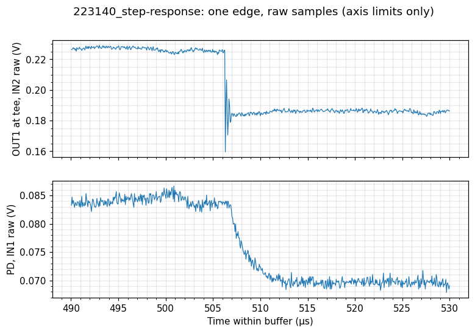
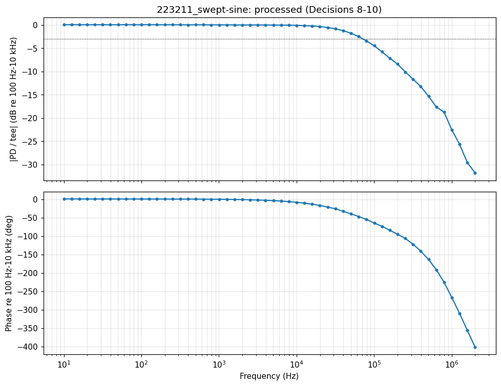
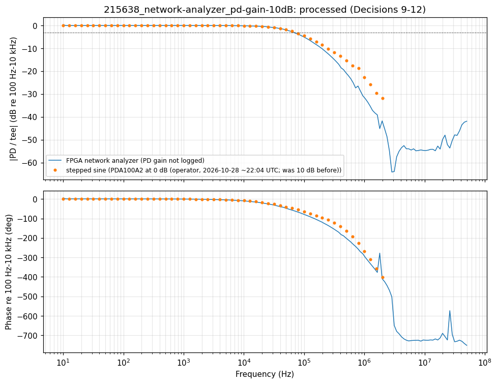
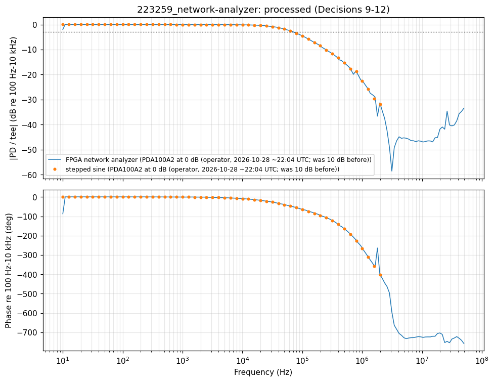
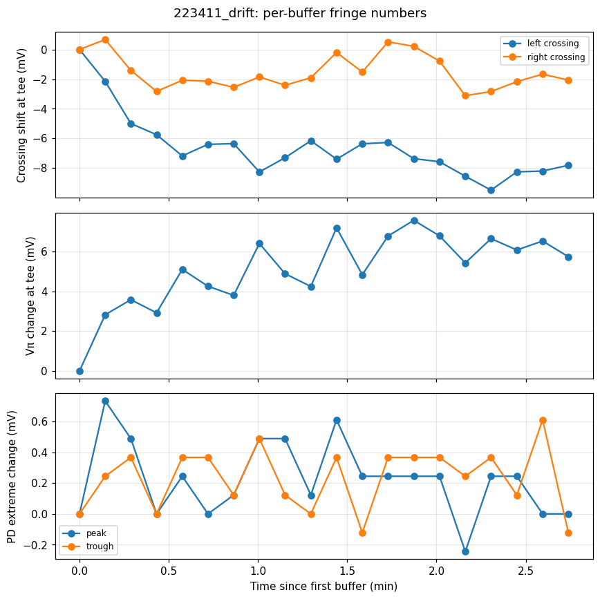
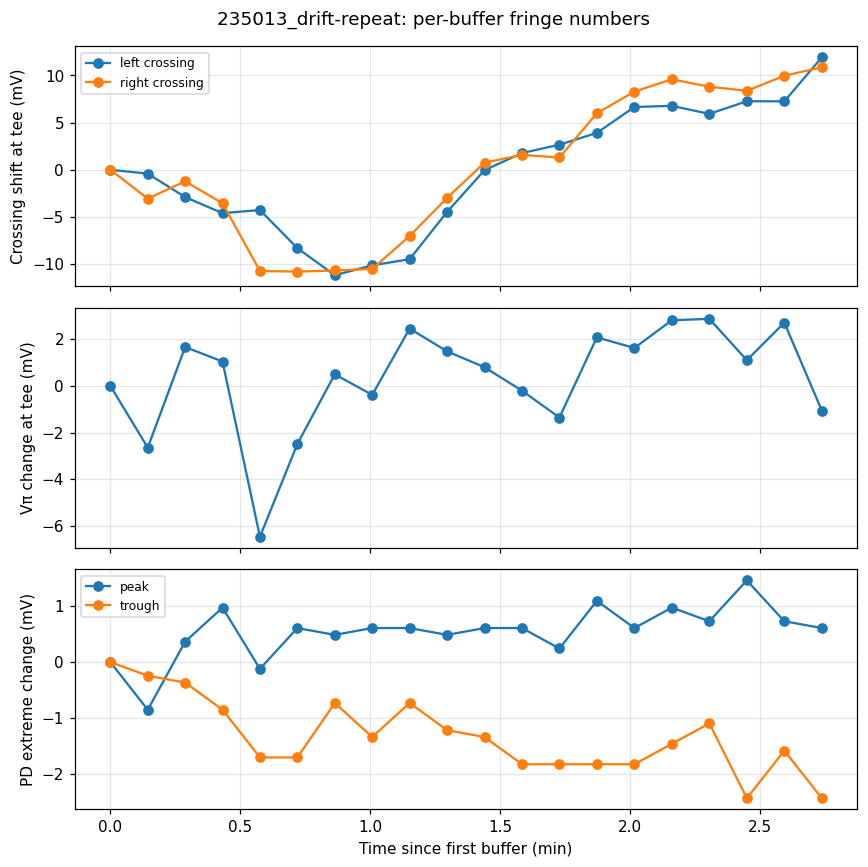

# 2026-10-28 — Repaired Newport 4004 EOM: drive chain, Vπ, frequency response, drift

**Notebook:** `notebooks/Tutorial-EOM_performance_characterization.ipynb` (sections Drive Check → Stability & Drift).
**Kept runs:** `runs/` (raw counts + metadata; driver source stored once in `sources/`). Superseded runs: `superseded_runs_2026-10-28.tar.xz`. Working notes: `agent_notes_2026-10-28.md`. Failed runs and one false start (22:28) were deleted.
**Bench (final pass, 22:30–22:37 UTC; drift repeat 23:50–23:53):** 830 nm; HWP 278°; PD Thorlabs PDA100A2 at 0 dB; RP IN1 = PD (LV), IN2 = OUT1 via BNC tee (LV); OUT1 → preamp → New Focus 3211 → EOM; TEC set to 10.75 kΩ, locks at 10.07 kΩ (operator: both correct; offset unexplained).

## Headline numbers (final pass)

| Quantity | Value | Category | Run |
|---|---|---|---|
| OUT1 at tee | $1.0118 \times$ command $+ 2.2$ mV; worst miss 0.3 mV over ±0.4 V | measured, two-point | `223008_drive-check` |
| $V_\pi$ | 0.5195–0.5207 V at tee = **0.5135–0.5147 V command** (5 buffers) | processed (Decisions 2–4) | `223032_vpi` |
| Raw visibility $(I_\max - I_\min)/(I_\max + I_\min)$ | 0.84 (0.74–0.77 during the 23:50 run) | raw; no dark measured at this gain | `223032_vpi`, `235013_drift-repeat` |
| −3 dB, PD/tee, re 100 Hz–10 kHz | **71.3 kHz** (stepped sine), **71.5 kHz** (FPGA NA); phase −51° | processed (Decisions 8–12) | `223211_swept-sine`, `223259_network-analyzer` |
| Step 10–90% | 3.65 µs → single-pole-equivalent 96 kHz (one edge) | processed (Decisions 5–7) | `223140_step-response` |
| Drift over 2.7 min | run 1: crossings −4.9 mV ($\Delta\Gamma_0 = +0.03$ rad), $V_\pi$ +5.7 mV at tee, peak/trough < 1 mV. Run 2 (73 min later, no runs recorded in between): crossings +11.4 mV last−first ($\Delta\Gamma_0 = -0.07$ rad) but 22 mV peak-to-peak (≈ 0.13 rad) within the run; $V_\pi$ −1.1 mV last−first with 0.5146–0.5240 V buffer-to-buffer scatter; trough −2.4 mV | processed (Decision 13) | `223411_drift`, `235013_drift-repeat` |
| HV per command volt | ≈ 406 V/V (one DC point at +0.30 V, DMM in place of EOM) | measured, single point; DMM values are operator readings recorded in the `bench` text of the 22:30 runs and in the notes, not in this run's metadata | `164028_hv-dc-hold-dmm` (RP side) |
| $V_\pi$ at electrode | ≈ 209 V | **inferred** (0.514 V × 406 V/V) | — |

## How we got there (the path, in numbers)

1. **Morning survey, IN2 = 3211 monitor.** Contrast only ~8%: input polarization was ~2° from a crystal axis (HWP had been set for "half-range DC"). $V_\pi \approx 0.50$ V command already visible.
2. **Offsets** (outputs off): IN2 zero on the HV range −0.1845 V (open and 50 Ω agree); PD dark −4.7 mV at PD gain 10 dB (`162510_dark-level`, `163053_in2-zero-50ohm`).
3. **Drive chain by DMM at 0.30 V command:** preamp out 3.148 V, 3211 out 121.8 V (×38.7), monitor 4.149 V on DMM (HV/29.4) but 2.903 V at RP IN2 (×0.70; loading or IN2 gain — open). OUT1 unloaded 0.354 V (×1.18) vs 1.012× at the tee (preamp input loading suspected).
4. **Safety finding:** 406 V/V exceeds the configured chain model (355.6), so 0.45 V runs reached ≈ ±183 V; command limit set to 0.48 V (≈ 195 V).
5. **HWP realigned** by maximizing the PD swing: contrast 8% → ~70%.
6. **Vπ in command volts** reproducible all day: 0.509–0.513 (18:51), 0.510–0.514 (21:11), 0.5135–0.5147 (22:30).
7. **Frequency response, three methods:** professor's spectrum analyzer knee ~18–30 kHz, probably ~30 (by eye on a log axis; ±0.1 V, unbiased; no record kept); stepped sine 66.1 kHz and FPGA NA 66.8 kHz at PD gain 10 dB; 71.3 / 71.5 kHz at 0 dB. Step equivalents 83–96 kHz. Referencing to the 10 Hz point instead of the flat band had shifted −3 dB by up to 25 kHz.

## Physics we used

**Fringe.** For a retarder between polarizers (input at $\alpha$, analyzer at $\beta$ to the crystal axes),
$$I(V) = A + B\cos\!\left(\Gamma_0 + \frac{\pi V}{V_\pi}\right),\qquad A = \cos^2\!\alpha\cos^2\!\beta + \sin^2\!\alpha\sin^2\!\beta,\quad B = \tfrac12\sin 2\alpha\,\sin 2\beta .$$
Angles change only $A$ and $B$ (contrast); the period in $V$ is always $2V_\pi$. With $\beta = 45°$, visibility $= |\sin 2\alpha|$: 8% meant $\alpha \approx 2.4°$. The HWP sets contrast, not the bias $\Gamma_0$.

**Why crossings, not peaks.** Near a peak $\Delta I = B\delta^2/2$, so one sample places it only to $(V_\pi/\pi)\sqrt{2\sigma/B}$; at a halfway crossing the slope is maximal ($B\pi/V_\pi$) and the error is $\sigma/(B\pi/V_\pi)$ — about 8× smaller. Neighbouring halfway crossings are exactly $V_\pi$ apart; one sweep needs ≳ 1.5 $V_\pi$ to contain two of them plus a peak and a trough.

**Small-signal frequency response.** Biased at a crossing, $\Delta I \approx (dI/dV)\,\Delta V$, so the PD follows the drive linearly. Software lock-in per frequency over whole cycles:
$$Z = \frac{2}{N}\sum_n x_n e^{-i2\pi f t_n},\qquad H(f) = \frac{Z_\text{PD}}{Z_\text{tee}} .$$
Step response of one pole: $t_{10\text{–}90} = \tau\ln 9$, $f_{-3\,\text{dB}} = \ln 9/(2\pi t_{10\text{–}90}) \approx 0.35/t_{10\text{–}90}$ — exact only for a single pole.

**Drift.** A crossing sliding by $\Delta V$ is $\Delta\Gamma_0 = -\pi\,\Delta V/V_\pi$; a change in crossing separation is a change in $V_\pi$; peak and trough moving apart is $B$, together is $A$.

## Figures

| | |
|---|---|
| Drive check: tee vs command, PD in step order |  |
| Vπ run: raw PD vs OUT1 (XY) and time traces |  |
| Step response, full buffer and one edge |   |
| Bode, stepped sine (raw buffers) |  |
| Bode, FPGA NA at PD gain 10 dB (215638) and final 0 dB (223259) with stepped sine overlaid |   |
| Drift, 20 buffers: run 1 (22:34) and run 2 (23:50) |   |

## Findings (calibrated)

1. The EOM modulates as expected: $V_\pi \approx 0.514$ V of OUT1 command, reproducible to ~1% across 4 h, linear across one fringe (equal quarter-fringe widths), no up/down loop at 1 Hz (< 1 mV).
2. The chain OUT1 → PD rolls off at ≈ 66–72 kHz (−3 dB), with more than one pole and ≈ 0.35 µs delay. Two methods agree to 1%. A 10 dB PD gain change moved it only 6%, which suggests the PD is not the main limit, but those two runs also differed in bias (0.166 vs 0.202 V) and contrast state. Preamp, 3211 into the EOM capacitance, or crystal — unresolved.
3. Above ~3 MHz the PD channel is gain-independent: electrical pickup, not light. The top of the Bode plot is the instrument floor.
4. Over minutes, $\Gamma_0$ wanders by up to ~0.13 rad (≈ 22 mV of drive peak-to-peak), not monotonically. In run 1 $V_\pi$ appeared to creep up ≈ 1% and level off (much of it rests on the first buffer); run 2, 73 min later with no runs recorded in between, started near run 1's end value (0.521 V at tee) and did not reproduce the creep. Run 2's buffer-to-buffer $V_\pi$ scatter (≈ 9 mV, likely fringe motion within each 8.6 s buffer) is larger than the creep, so one repeat cannot settle its cause. Between the runs the fringe slid ~15 mV and the contrast dropped (raw visibility 0.84 → 0.74–0.77).
5. Contrast changed between runs (0.69 → 0.76 → 0.64 dark-subtracted at 10 dB gain; 0.84 raw at 0 dB) while laser power stayed constant: consistent with a contrast state change, cause unknown.

## Open items (ranked; cheapest check)

1. Pickup near 65 kHz contaminates the Bode shape above ~100 kHz → beam-blocked network pass.
2. Contrast switching and the low-contrast noise state → hold DC at the trough, watch PD noise, log laser current/temperature.
3. Where the ~70 kHz pole sits → swap in the Thorlabs EOM on the same chain; 3211 datasheet into a capacitive load.
4. $V_\pi$ creep (seen in run 1, not in run 2) and the wandering $\Gamma_0$ → longer drift runs with logged TEC/laser state.
5. Tee rises with frequency (+7% at 50 kHz) → tee into IN1 and IN2 together.
6. 40–50 kHz ripple on OUT1 → DC with preamp unplugged.
7. Electrode-volt $V_\pi$ rests on one DMM point; monitor ×0.70 and OUT1 ×1.18 unexplained; dark level not measured at PD gain 0 dB; TEC locks 0.68 kΩ from its setpoint.
8. Still to run: beam-blocked network pass; ±0.01 V amplitude repeat; dark at PD gain 0 dB. Raw data is local-only (no backup yet).
9. Pending decisions: 4 ($V_\pi$ in command volts) and the unwrap part of 10 and 12. Step cell used only one edge.
10. The 1 Hz drive is 1.048 Hz after ASG quantization (harmless for the XY $V_\pi$).
