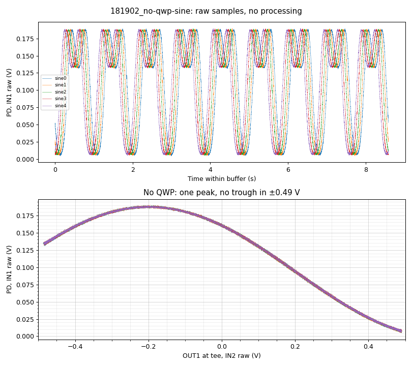
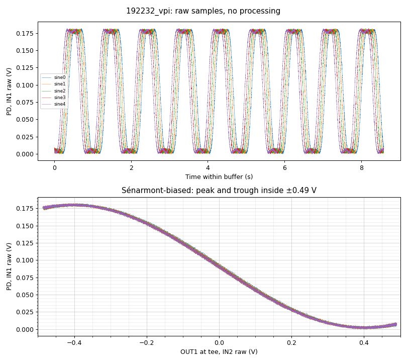
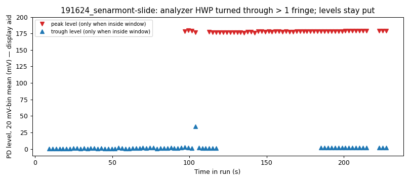
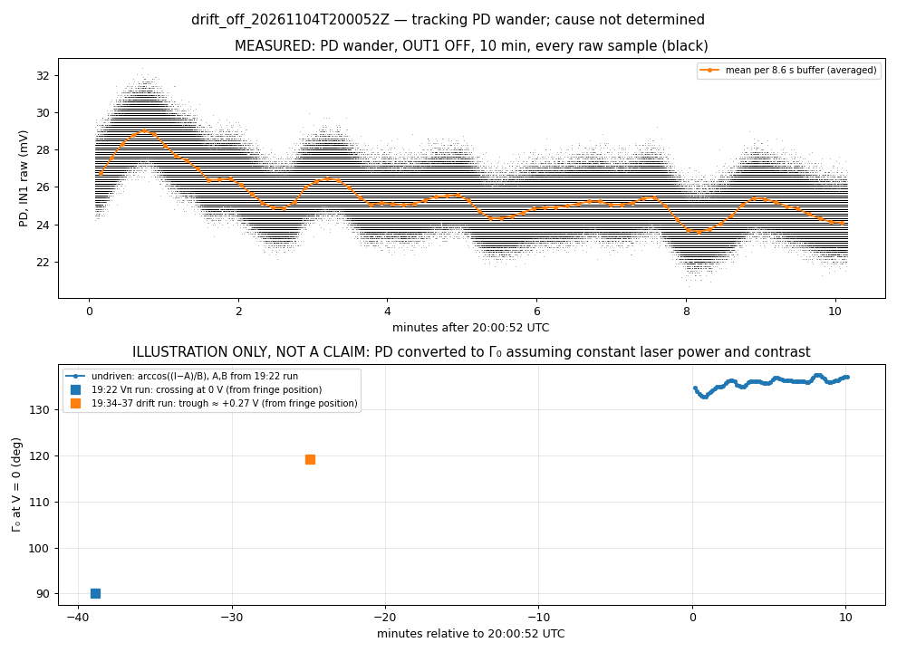

# 2026-11-04 — Thorlabs EO-PM-NR-C1: Sénarmont bias, retardance Vπ, PD wander

**Notebooks:** `notebooks/Tutorial-EOM_performance_characterization.ipynb` (acquisition), `notebooks/Tutorial-QWP_Senarmont_alignment.ipynb` (new one-off alignment notebook; not yet run on hardware — today's alignment used its prototype, `sources/qwp_align.py`).
**Kept runs:** `runs/`. Superseded (archived, verified): `superseded_runs_2026-11-04.tar.xz` (18:18 dc points, 18:48/18:52 unexamined no-QWP repeats, 19:10 null hunt). Working notes: `agent_notes_2026-11-04.md`. Bench-log corrections confirmed by the operator are in each run's `operator_corrections.md` (`metadata.json` untouched).
**Bench:** 830 nm; PD PDA100A2 at 0 dB; IN1 = PD (LV), IN2 = OUT1 via BNC tee (LV); OUT1 → preamp (×8.89, operator) → New Focus 3211 → EO-PM-NR-C1. Optics from 19:22: input HWP 300° → EOM → **QWP 130°** → analyzer HWP 230° → PBS → PD. TEC as 2026-10-29. 3211, HV and laser left on at close.

## Headline numbers

| Quantity | Value | Category | Run |
|---|---|---|---|
| $V_\pi$ (retardance), at tee | **0.79 V** by eye (peak → trough); single-sample extremes per buffer 0.77–0.83 V | raw | `192232_vpi` |
| $V_\pi$, command volts | **≈ 0.78 V** (0.79 V tee ÷ 1.0118) | raw ÷ measured tee gain | `192232_vpi`, `192205_drive-check` |
| $V_\pi$ without QWP | ≥ 0.69 V at tee (peak to sweep edge; no trough in window) | raw lower bound | `181902_no-qwp-sine` |
| Dark level, PD 0 dB | −6.0 to −6.3 mV (buffer means c0100–c0170, beam blocked; the rest of that run is lit) | raw | `190929_dark-level` |
| Ratio to Newport 4004 (0.514 V command, 2026-10-28, same chain) | ≈ 1.52 (0.78 / 0.514) | derived | — |
| $V_\pi$ at electrode | ≈ 272 V (0.79 V tee × 8.89 × 38.7) or ≈ 318 V (preamp × 10.4) | **inferred**, HV gain unverified with this EOM | — |

Not adopted (no Decisions row): cosine fit of the no-QWP run, 0.79–0.81 V tee; adversary's binned extrema, 0.802–0.805 V tee.

## How we got there

1. **No QWP (18:19).** One fringe peak at −0.20 V tee; PD still falling at the +0.49 V edge → not a $V_\pi$. The 0.48 V command limit (3211 ±200 V output is the binding hardware limit; RP ±1 V and preamp ×8.89 are not) cannot hold a peak and a trough unless $\Gamma_0$ happens to place them there.
2. **Sénarmont QWP (19:09–19:20).** Dark −6.2 mV; null hunt reached +0.2…+0.4 mV; slide test: turning the analyzer moved the fringe through more than one period while peak (176–180 mV) and trough (0.1–2.2 mV) levels stayed put → QWP aligned.
3. **Vπ run (19:22).** Peak ≈ −0.40 V, trough ≈ +0.40 V tee, one halfway crossing ≈ 0 V, 5 buffers overlapping.
4. **PD wander (19:34, 20:01).** Trough moved ≈ −0.14 V tee by 19:34 (peak left the window, so trough position only); 10 min with OUT1 off: PD 26.7 → 24.1 mV, 5.4 mV p-p.

## Physics used

$$I(V) = A + B\cos\!\left(\Gamma_0 + \frac{\pi V}{V_\pi}\right)$$
Waveplate angles change only $A$ and $B$; a DC offset only slides a smaller sweep inside the same fixed window. **Sénarmont:** input at 45° to the crystal axes, EOM, QWP with fast axis along the input polarization, analyzer at $\theta$:
$$\mathbf E = \cos\tfrac{\Gamma}{2}\,\hat u + \sin\tfrac{\Gamma}{2}\,\hat w \;\Rightarrow\; I = \tfrac{I_0}{2}\left[1+\cos(\Gamma - 2\theta)\right],$$
so an analyzer-HWP turn $\varphi$ shifts the bias by $4\varphi$ at constant contrast. **Retardance vs phase $V_\pi$** (LiNbO₃, field along $z$): $V_{\pi,\text{ret}}/V_{\pi,\text{phase}} = n_e^3 r_{33}/(n_e^3 r_{33} - n_o^3 r_{13}) \approx 1.45$ (textbook constants). The polarimeter uses retardance.

## Figures

| | |
|---|---|
| No QWP: raw XY, one peak, no trough |  |
| Vπ run: raw time traces and XY |  |
| Slide test: peak/trough levels while turning the analyzer (20 mV-bin means, display aid; the one 34 mV point is a buffer taken mid-turn) |  |
| PD wander, OUT1 off, 10 min. Top: measured. Bottom: Γ₀ conversion, **illustration only, not a claim** (assumes constant laser power and contrast) |  |

## Findings (calibrated)

1. With the Sénarmont bias, one fringe peak and trough fit inside the ±0.49 V tee window; peak-to-trough is ≈ 0.79 V of tee (raw, by eye), consistent with the no-QWP lower bound.
2. The QWP shifted the fringe without a visible change in contrast, as the model predicts for an aligned QWP.
3. **PD wander is tracked only; no cause is claimed.** The fringe position moved between runs (trough ≈ 0.14 V tee in 12 min after heavy driving), and the undriven PD wandered 5.4 mV p-p over 10 min. One PD cannot separate retardance drift from laser-power drift.
4. The square, sweep and network runs (19:27–19:30) were biased at −0.006 V command from an invalid cell; PD sat at 39–57 mV vs ≈ 91 mV halfway → off quadrature. Kept, unexamined.

## Open items (ranked)

1. DMM: HV per command volt with this EOM connected (344 vs 406 V/V in the notebook); EOM voltage rating from the datasheet.
2. Notebook fixes (need approval): the Vπ cell (Decisions 2–4) silently returns ≈ 0.012 V when only one crossing is in the window; the drift cell likewise; `bias_v` derives from it. Choose a peak → trough method and record it in the Decisions table.
3. Decisions to settle: QWP notebook A1–A3 (proposed); cosine fit (not adopted).
4. PD wander: second PD on the other PBS port (power vs retardance); temperature log.
5. Near-null noise ≈ 2.4 mV (vs 0.8 lit, 1.2 dark) unexplained; trough ≈ 6–8 mV above dark.
6. Next session: drift-run quiz (tutor); BNC push-pull → single protected BNC adapter for the Conoptics 302 (built elsewhere), then a Vπ sanity check on that chain; then Jones matrices.
7. Raw data is local-only (no backup).
