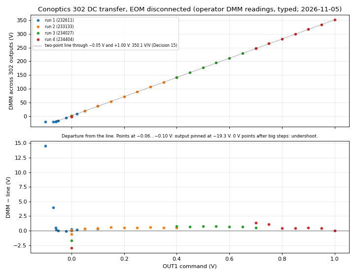
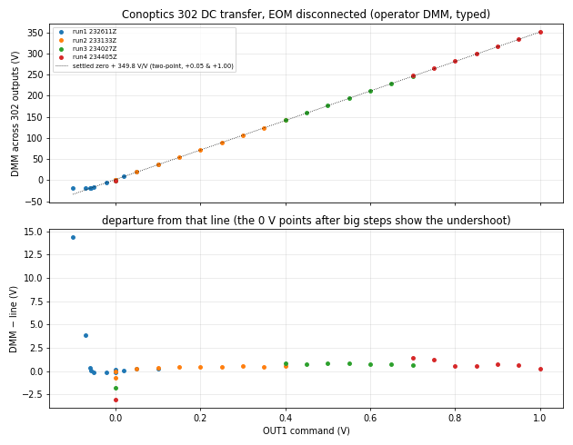
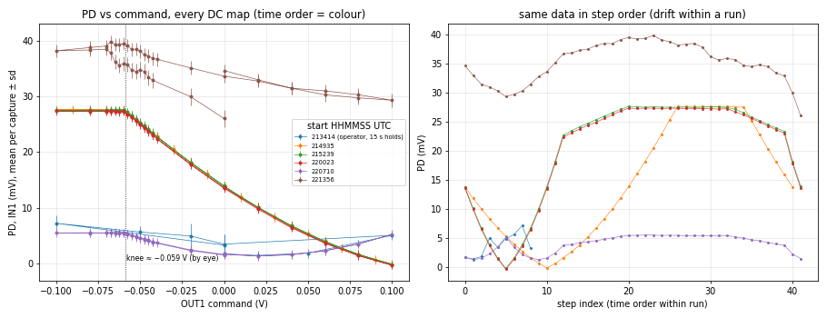
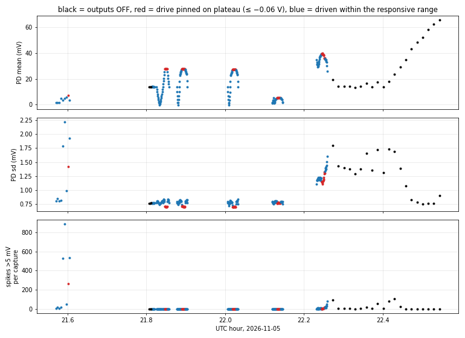

# 2026-11-05 — Conoptics 302 first connected: DC transfer by DMM, negative limit, undriven PD wander

**First day on the Conoptics 302 HV driver** (base model, older; single input, push-pull outputs), replacing the preamp → New Focus 3211 chain. The Vπ and bandwidth on this driver came the next day: see **`../2026-11-06/SUMMARY.md`** (main report).

**Kept runs:** `runs/`. Everything from the agent campaign and the tag team (39 runs, harness, plans, logs, the DMM log) is in `agent_302_campaign_2026-11-05-06.tar.xz` (verified by `diff -r` before the working folder was deleted). Working notes (verbatim REQUEST, PLAN, draft SUMMARY, LOG, tag-team RESULTS and DMM log): `agent_notes_2026-11-05.md`. Scripts: `sources/`.
**Bench:** 830 nm; RP OUT1 → BNC tee (→ IN2, LV) → Conoptics 302 (bias needle ≈ 225 V, zeroed by DMM on the push-pull outputs with OUT1 connected) → push-pull outputs → enclosed 16 AWG adapter (centre of one output → SMA centre, centre of the other → SMA ground; operator's description 11-06) → EO-PM-NR-C1 (insulating box, TEC 11.70 set / 11.63 read). Optics: input HWP 300°, QWP 130°, analyzer HWP 230° → PBS → PDA100A2 at 0 dB → IN1 (LV). For the DMM tag team the EOM was **disconnected** and a DMM read across the two 302 output centres (banana breakouts; polarity labels unknown, sign as displayed).

## Headline numbers

| Quantity | Value | Category | Runs |
|---|---|---|---|
| 302 DC gain | **350.1 V/V** (two-point: −0.05 V → −16.25 V, +1.00 V → +351.4 V); per step 358 → 350 V/V | raw DMM, two-point (Decision 15) | `232611`–`234404` |
| Positive range | linear to **+351.4 V** at +1.00 V (RP OUT1 maximum); no positive limit seen | raw DMM | `234404` |
| Negative limit | output **pins at −19.3 V** for ≤ −0.060 V command (−18.89 V at −0.058 V still linear) | raw DMM | `232611` |
| Settled zero | +1.25 … +1.51 V (4 readings before large excursions) | raw DMM | `232611`, `233133` |
| Return undershoot | 0 V read right after 142 / 247 / 351 V: +0.6 / −0.4 / −1.7 V, recovering over tens of seconds (≈ −0.8 / −1.8 / −3.1 V below the settled zero) | raw DMM, timing approximate | `233133`, `234027`, `234404` |
| PD knee | PD stops responding below ≈ −0.059 V command (same command as the −19.3 V pin; EOM connected) | raw, knee by eye | `214935` + maps in the archive |

## Tag-team DMM readings (typed by the operator; command V → DMM V)

| Run | Readings in step order |
|---|---|
| 1 (`232611`) | 0 → 1.37; 0.02 → 8.47; 0.05 → 19.09; 0.10 → 36.6; 0 → 1.25; −0.02 → −5.79; −0.05 → −16.25; −0.058 → −18.89; −0.06 → −19.28; −0.07 → −19.29; −0.10 → −19.27; 0 → 1.51 |
| 2 (`233133`) | 0 → 1.37; 0.05 → 19.09; 0.10 → 36.67; 0.15 → 54.33; 0.20 → 71.8; 0.25 → 89.3; 0.30 → 106.9; 0.35 → 124.3; 0.40 → 141.8; 0 → 0.7, then 1.01, 1.1, 1.3, 1.33, 1.35 over ≈ 1 min |
| 3 (`234027`) | 0.40 → 142.1; 0.45 → 159.5; 0.50 → 177.1; 0.55 → 194.6; 0.60 → 212.0; 0.65 → 229.5; 0.70 → 246.9; 0 → −0.4 |
| 4 (`234404`) | 0.70 → 247.7; 0.75 → 265.0; 0.80 → 281.8; 0.85 → 299.3; 0.90 → 316.9; 0.95 → 334.3; 1.00 → 351.4; 0 → −1.7, "on its way to positive" |

Repeatability: 0.05 V 19.09/19.09; 0.10 V 36.6/36.67; 0.40 V 141.8/142.1; 0.70 V 246.9/247.7 V.

## Agent discovery campaign (21:48–22:33, gate ±0.10 V, outputs off / DC points only)

1. The PD plateau below ≈ −0.059 V is the 302's negative limit (confirmed by the DMM later, EOM disconnected).
2. The PD wanders and spikes **with no drive**: outputs off, 13.4–19.1 mV for ≈ 9 min (3–95 spikes per capture), then a steady rise 17.7 → 65.4 mV over ≈ 8 min (figure 3). No cause is claimed; whether driving triggers the noisy state is untested.
3. Process errors (agent, disclosed): plan v2 started without a pre-run adversary review; the stop rule was implemented as "> 50 spikes per capture" instead of the plan's "spike rate grows run to run", so one map (221356Z) should not have run.

## Figures

| | |
|---|---|
| 302 DC transfer (redrawn): line through the Decision 15 points (−0.05 V, +1.00 V) = 350.1 V/V; bottom: departure from that line (pinned points and post-step undershoot visible) |  |
| Original tag-team figure: its line is the two-point gain through +0.05 V and +1.00 V (349.8 V/V) on the 1.38 V settled zero, **not** Decision 15 |  |
| Agent DC maps with the EOM connected: PD vs command (per-capture mean ± sd): flat below ≈ −0.059 V in the three fine maps (215239, 220023, 220710) although level and slope differ; not clear in the operator's 21:34 run or in 221356 (drift within the run) |  |
| PD over the campaign, outputs off (black) and driven: wander and jumps without drive (per-capture means) |  |

## Open items

Carried into `../2026-11-06/SUMMARY.md`. Specific to this day: the PD wander/spike source (beam blocked, 302 off or EOM unplugged, second PD, TEC log), and which 302 output is "+" (polarity only).
