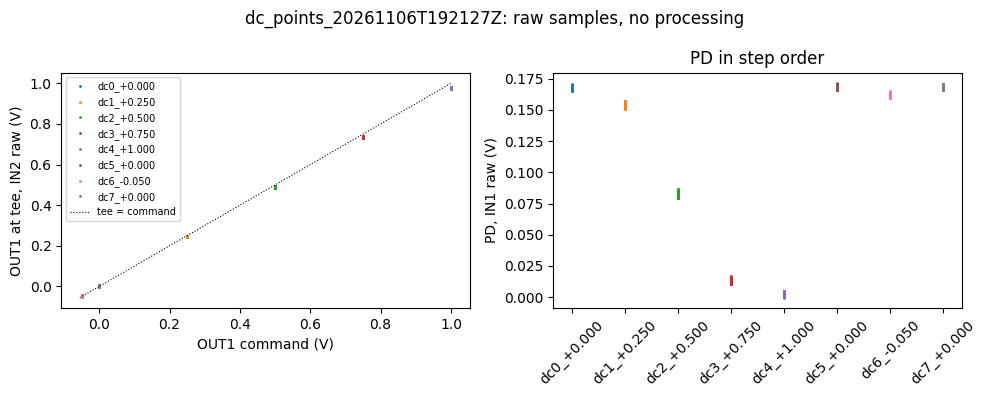
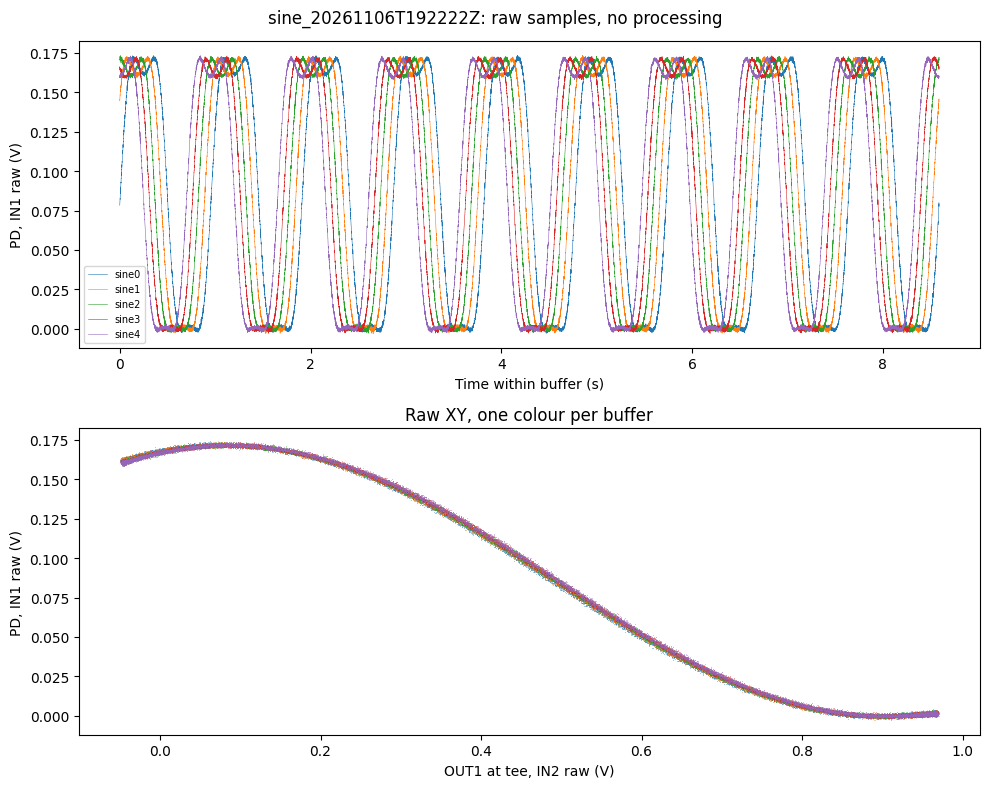
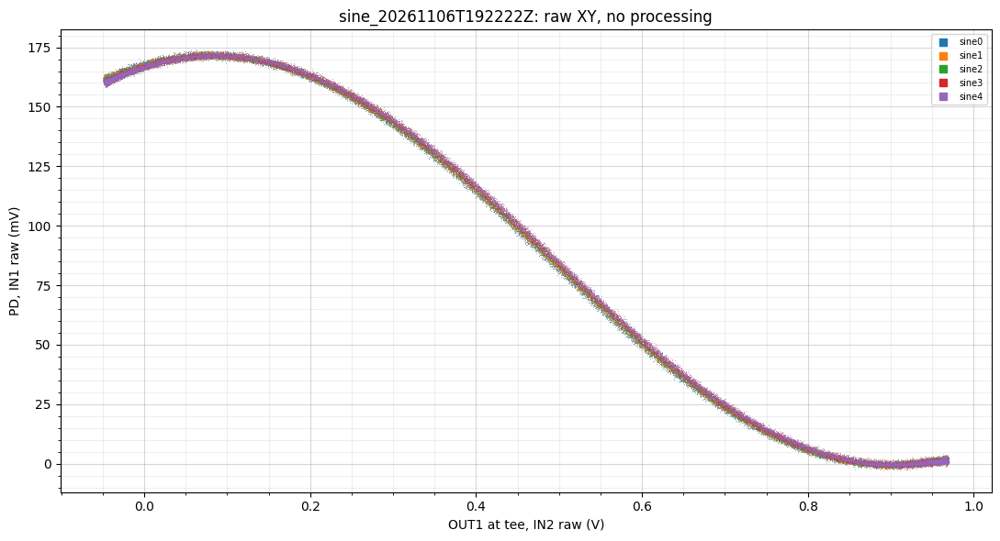
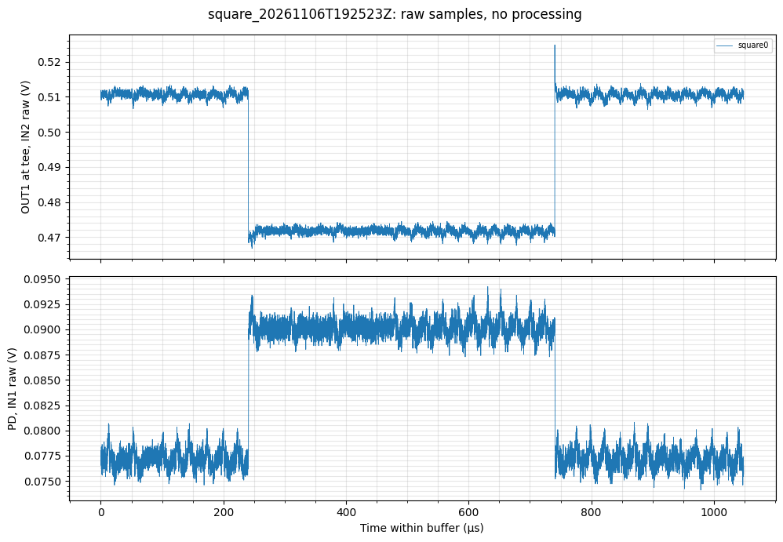
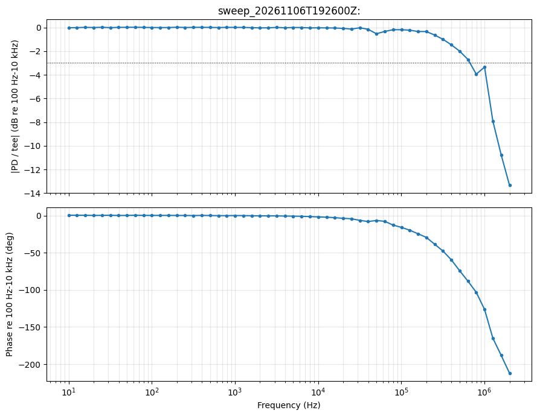
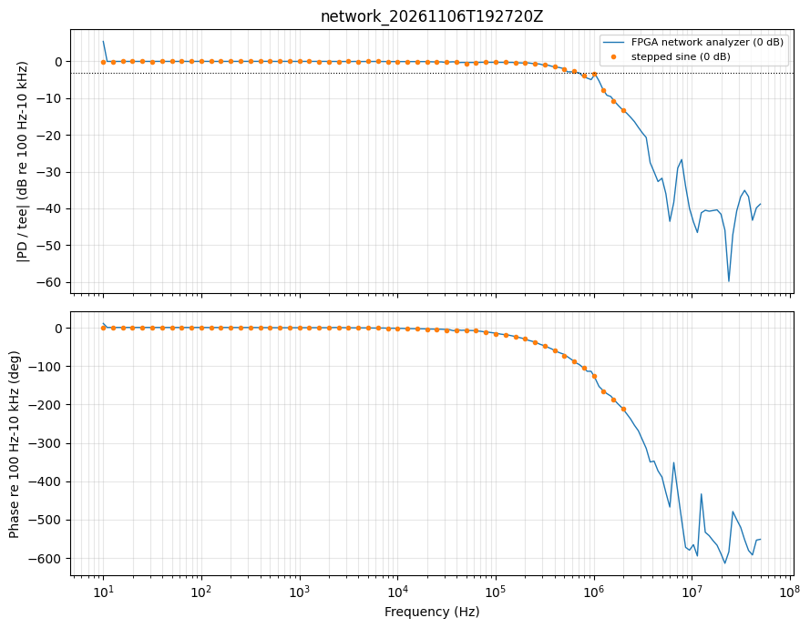
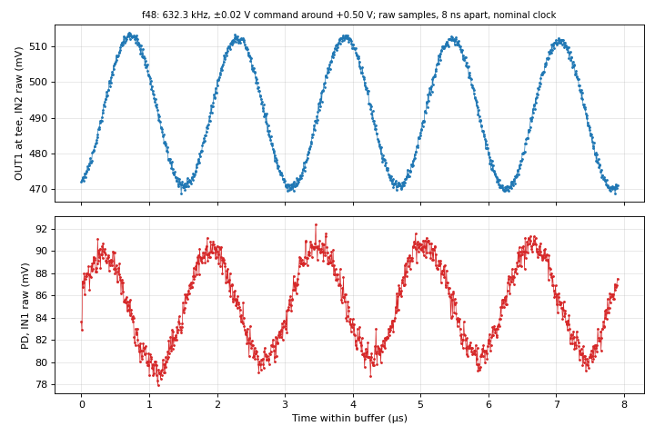

# 2026-11-06 — Conoptics 302: first Vπ and first bandwidth on the new driver (first connected 2026-11-05)

**This is the first characterization of the Conoptics 302 HV driver** (base model, older; single input, push-pull
outputs) in this experiment. It replaces the preamp ×8.89 → New Focus 3211 chain used through 2026-11-04. The 302 was
first connected on 2026-11-05 (DC transfer by DMM, see `../2026-11-05/SUMMARY.md`); today gave its first Vπ and its
first frequency response.

**Notebook:** `notebooks/Tutorial-EOM_performance_characterization.ipynb` (acquisition and analysis, executed 19:21–19:28 UTC; the drift stage was not run).

**Kept runs:** `runs/`. Everything from the 11-05/06 agent campaign and tag team is in `../2026-11-05/agent_302_campaign_2026-11-05-06.tar.xz` (verified by `diff -r`). Operator corrections to logged bench facts are in each run's `operator_corrections.md` (`metadata.json` untouched). Working notes, agent and adversary reviews: `agent_notes_2026-11-06.md`; scripts in `sources/`.

**Bench:** 830 nm; RP OUT1 → BNC tee (→ IN2, LV) → **Conoptics 302** (bias needle ≈ 225 V, re-set by the operator after the preamp tests) → push-pull outputs → enclosed 16 AWG adapter (centre of one output → SMA centre, centre of the other → SMA ground) → Thorlabs EO-PM-NR-C1 (insulating box, TEC 11.70 set / 11.63 read) → input HWP 300°, QWP 130°, analyzer HWP 230° → PBS → PDA100A2 at 0 dB → IN1 (LV). BNC shells of the push-pull connections at the EOM enclosure grounded to chassis (see note).

## Findings

| # | Quantity | Value | Category | Runs |
|---|---|---|---|---|
| 1 | 302 DC gain (EOM disconnected) | **350.1 V/V** (−0.05 V → −16.25 V; +1.00 V → +351.4 V); per step 358 → 350 V/V | raw DMM, two-point (Decision 15) | 11-05 tag team 1–4 |
| 2 | 302 output range | linear to **+351.4 V** at +1.00 V (RP maximum); **pins at −19.3 V** for ≤ −0.06 V | raw DMM | 11-05 tag team 1–4 |
| 3 | 302 zero and recovery | settled +1.25 … +1.51 V; right after returning from 142 / 247 / 351 V: +0.6 / −0.4 / −1.7 V, recovering over tens of seconds | raw DMM, timing approximate | 11-05 tag team 2–4 |
| 4 | Preamp in front of the 302 (rejected) | preamp gain ≈ 10.1–10.5× (label 8.89); with the 302 connected the preamp→302 node stops at **0.247 V**, so the 302 output tops out ≈ 60 V above its zero | raw DMM | `175858`, `190115`, `191013` |
| 5 | Tee, RP direct | 0.9752 × command + 1.8 mV (worst miss 1.7 mV) | raw, two-point (Decision 1) | `192127_drive-check` |
| 6 | Fringe | PD 173.6 mV peak, −2.6 … −3.2 mV lowest sample (dark not subtracted); peak and trough both turn over inside the sweep | raw | `192222_vpi` |
| 7 | **Vπ (retardance), command** | **0.84 ± 0.02 V** (peak 0.08 → trough 0.90 V at the tee, read by eye; ÷ tee gain) | raw read (Decision 17) ÷ tee gain (Decision 4, pending) | `192222_vpi`, `192127_drive-check` |
| 8 | **Vπ at the EOM** | **≈ 294 ± 8 V** (11-04 prediction 272–318 V) | **inferred**: 302 gain measured with the EOM disconnected at the 11-05 needle setting | + row 1 |
| 9 | **Small-signal −3 dB, whole chain** (302 + adapter + EOM + PD), ±7 V at the 302 | **≈ 0.6–0.75 MHz**: 668.6 kHz stepped sine, 671.0 kHz network analyzer; phase −92° there | processed (Decisions 8–12; phase unwrap pending) | `192600_sweep`, `192720_network` |
| 10 | Shape of the roll-off | not a single pole: ≈ 0.19 µs delay, steeper than 20 dB/decade above the knee, repeatable bump near 1.0 MHz in both methods | processed / inferred | same |
| 11 | Step | t₁₀₋₉₀ = 0.40 ± 0.03 µs (2 edges) → single-pole equivalent 865 kHz | processed (Decisions 5–7) | `192523_square` |
| 12 | Full-swing (±147 V) bandwidth | ≳ 21–30 kHz (lower bound from no visible slew distortion; not measured) | inferred | see the bandwidth section |

Error bars on rows 7–8 are the spread of independent readings (agent and adversary chord midpoints, up vs down sweeps, buffer to buffer), not a fit. The ≈ 0.6–0.75 MHz range is quoted because the network analyzer sits between −2.8 and −3.1 dB from 540 to 714 kHz, so a 0.15 dB change in the reference moves the "−3 dB" frequency by more than ±80 kHz.

## How we got there

1. **11-05: first connection.** An autonomous agent campaign (gate ±0.10 V) found that the PD stops responding below about −0.059 V command. A tag team (agent holds a voltage, operator types the DMM reading across the 302 outputs, EOM disconnected) then mapped the 302 to the RP maximum: 350.1 V/V, linear to +351 V, pinned at −19.3 V. That pin is the PD knee.
2. **11-06, preamp (17:55–19:13).** To reach ≈ 420 V the preamp was put in front of the 302. The 302 output flattened at ≈ 77 V (≈ 60 V after re-zeroing the bias). Unloaded, the preamp stayed linear to 0.366 V (×10.2). Loaded by the 302, its output stopped at 0.247 V, while the 302 kept following its input (320 V/V incremental). The preamp was removed: **RP direct (−19 … +351 V) is the usable drive.**
3. **11-06, notebook (19:21–19:28).** Sine on a DC offset (0.47 ± 0.52 V command ≈ −16 … +348 V from the DMM table, about 1.2–1.4 Vπ). The halfway-crossing method needs ≈ 1.5 Vπ, so Vπ was read as peak → trough on the raw XY. Bias at the midpoint (+0.5006 V command, quadrature). Then step, stepped sine and network analyzer at ±0.02 V.
4. **Review.** Adversary A (code only, predicting failure modes), adversary B (independent data analysis) and the agent agreed. Ruled out by the data: IN2 clipping (8029 of 8191 counts at +1 V), the −19 V pin flattening the low end, pickup spikes at the step edge, and bias drift large enough to matter (mean PD 83.5–85.9 mV over the whole sweep). The PD setting the knee is unlikely (recalled spec, below) but not tested.

## Physics used

**Vπ from one peak and one trough.** For a retarder between polarizers (Sénarmont),
$$I(V) = A + B\cos\!\left(\Gamma_0 + \frac{\pi V}{V_\pi}\right).$$
A peak and the next trough differ in phase by π, so their x-distance is $V_\pi$, whatever $\Gamma_0$, $A$ and $B$ are. Halfway between them the slope is largest, $|dI/dV|_\text{max} = \pi B/V_\pi$. Check: $B ≈ 86$ mV and $V_\pi = 0.82$ V (tee) give 0.33 mV/mV, the measured small-signal slope.

## Small-signal bandwidth vs large-signal slew rate (LV vs HV)

**Small signal (what was measured).** While the driver is linear, output and input are related by a transfer function, $V_\text{out}(f) = H(f)\,V_\text{in}(f)$, and the −3 dB point is where $|H| = 1/\sqrt 2$. Linearity means $H$ does not depend on amplitude: a ±7 V test and a ±0.7 V test give the same knee. Today's 0.6–0.75 MHz is this number, for the whole chain, at ±0.02 V command (±7 V at the 302: ±2.4 % of Vπ, 4.8 % peak to peak).

**Large signal (what was not measured).** An HV amplifier has a maximum output current $I_\text{max}$, and the EOM plus cable is a capacitor $C$. Since $I = C\,dV/dt$, the output cannot change faster than the slew rate
$$SR = \left|\frac{dV}{dt}\right|_\text{max} \;\le\; \frac{I_\text{max}}{C}\quad(\text{or less, from internal stages}).$$
A sine $V(t) = V_p \sin 2\pi f t$ has its steepest slope at the zero crossing, $dV/dt|_\text{max} = 2\pi f V_p$. It passes undistorted only if $2\pi f V_p \le SR$, which defines the **full-power bandwidth**
$$f_\text{FP} = \frac{SR}{2\pi V_p}.$$
Unlike the small-signal knee, $f_\text{FP}$ **falls as the amplitude grows**. Above it the sine turns into a triangle (odd harmonics; a full triangle has a 3rd harmonic of $1/9 ≈ 11\,\%$) and its amplitude shrinks.

**Which limit binds.** The two are equal at $V_p^* = SR / (2\pi f_{-3\,\text{dB}})$. For $V_p < V_p^*$ the small-signal knee sets the bandwidth; above $V_p^*$ the slew rate does. So "the 302 + EOM have 670 kHz of bandwidth" is true only for small swings. A polarimeter that drives the EOM through a large fraction of Vπ needs $f_\text{FP}$ at that amplitude.

**What today's data allow (inferred, a lower bound).** At 632 kHz and ±0.02 V command (7.0 V commanded at the 302; perhaps ≈ 5 V delivered, since the chain is −2.7 to −2.9 dB there (stepped sine / network analyzer)) the PD stayed sinusoidal (figure 5): 3rd harmonic 0.34 % (neighbouring frequencies 0.06–0.14 %), far below ≈ 11 %. Then
$$SR \gtrsim 2\pi \times 632\ \text{kHz} \times (5\text{–}7\ \text{V}) \approx 20\text{–}28\ \text{V/µs},$$
and for a full-Vπ swing ($V_p ≈ 147$ V)
$$f_\text{FP} \gtrsim \frac{20\text{–}28\ \text{V/µs}}{2\pi \times 147\ \text{V}} \approx 21\text{–}30\ \text{kHz}.$$
This is loose: the chain attenuates the 1.9 MHz harmonic itself, so a little distortion could hide. The true full-swing bandwidth lies somewhere between ≈ 21 kHz and ≈ 0.7 MHz. The peak current needed is $I_p = 2\pi f V_p C$ (C from the EOM datasheet, not checked).

**How to measure it.** Rerun the stepped sine at 0.01, 0.02 and 0.05 V peak (the notebook's safety cap for fast drive is 0.05 V): a knee that moves down with amplitude means slew. For swings near Vπ the PD is no longer a linear readout (the fringe folds), so the HV side must be measured directly (×100 HV probe or capacitive divider on the electrode).

## Figures

| | |
|---|---|
| Drive check: tee vs command and PD per step (raw) |  |
| Vπ run: raw time traces and XY (notebook `raw_look`) |  |
| Vπ run: raw XY on a fine grid, as used to read peak ≈ 0.08 V and trough ≈ 0.90 V (tee). The trough rises only ≈ 1.7 mV before the sweep ends at 0.97 V: the weak point of the reading |  |
| Step response, ±0.02 V at 1 kHz, raw (64 ns samples; only 2 edges in the buffer) |  |
| Stepped-sine Bode plot: \|PD/tee\| normalized to the median over 100 Hz–10 kHz; phase unwrapped (Decision 10 unwrap pending) |  |
| Network analyzer vs stepped sine, same normalization. The +5 dB first point (10 Hz) is a settling artifact; above ≈ 3 MHz the trace is at the ≈ −40 dB floor |  |
| Raw IN2 and PD at 632 kHz (stepped-sine capture f48), 5 cycles, no processing: the PD stays sinusoidal (no slew triangle) |  |

## Findings (calibrated)

1. **The Vπ is real.** Peak and trough turn over inside the window in all 5 buffers and in up and down sweeps (agree within ≈ 5 mV). The fringe slid ≈ 8 mV in 45 s but the peak-to-trough spacing did not change. Reading the DMM table directly at the two commands gives 294.6 V (arithmetic on the same 11-05 data as the gain, not an independent check), and the small-signal slope matches $\pi B/V_\pi$ within 1–2 %.
2. **The ≈ 0.6–0.75 MHz knee is real, and belongs to the whole chain, not the EOM.** Two independent methods agree. The PDA100A2 at 0 dB is ≈ 11 MHz (recalled from the Thorlabs table, not checked), so it is unlikely to set the knee; the 302 driving the EOM capacitance (perhaps with the adapter wiring) is the likely limit, inferred, with no HV-side measurement.
3. **The roll-off is not a single pole**, so the step's 865 kHz is a symptom of that shape, not a cross-check of the swept result. The bump near 1.0 MHz is repeatable and unexplained (a resonance, e.g. acoustic in the crystal, or the adapter wiring are guesses).
4. **The preamp cannot drive the 302** above 0.247 V; whether that is a current limit, clamping or a low 302 input impedance is not separated.
5. **The 302 incremental gain was 320 V/V when driven by the preamp**, vs 350.1 V/V from the RP alone (11-05). Unexplained.

## Observational note: grounding and 60 Hz (operator, 2026-11-06)

Without grounding the push-pull BNC connections at the EOM enclosure, a static 60 Hz wiggle appeared on the PD, attributed to pickup on the wires. The BNC shells were grounded to chassis for all 19:21–19:28 runs. Operator: a "super slight wiggle" remained, not noticeable at 100 mV/div on the scope. Observation only: no ungrounded run was saved and nothing was quantified.

## Decisions status

Approved: 1, 5–9, 11, 10 and 12 (reference band only), 15 (two-point HV gain), 16 (offset sine); bias by hand from the raw XY; settle 30 s; `hv_limit_v` 420 V (operator confirmed the EOM and chain handle it). 17 (Vπ = |peak − trough| read by eye; approved 2026-11-10, operator's own reading: peak 0.08–0.09 V, trough 0.90 V at the tee). **Pending:** 4 (÷ tee gain), 10 (phase unwrap part), the edge warning. Retired for this window: halfway crossings (Decisions 2–3; need ≥ 1.5 Vπ).

## Open items (ranked)

1. Turn the analyzer HWP a few degrees so the trough sits ≥ 0.1 V inside the window; rerun Vπ.
2. Amplitude series of the stepped sine (0.01 / 0.02 / 0.05 V) for slew; an HV probe for large swings.
3. 302 gain at today's needle setting, ideally with the EOM connected (the 294 V depends on it; command Vπ does not); the 320 vs 350 V/V question.
4. Separate the 302 from the EOM and PD (HV probe; move or shorten the adapter wiring and see whether the 1 MHz bump moves).
5. Notebook: cell 23 keeps the typed peak/trough after a rerun (proposed fix: record the run name with the typed values); drift stage not run.
6. PD wander and spikes with no drive (11-05) and the residual 60 Hz: untested whether related.
7. Raw data is local-only (no backup).

## Provenance

Runs record git 388120d (dirty: the notebook), Python 3.10.20, numpy 2.2.5, pyrpl 0.9.8.0, and the driver sources (`sources/_rp_drive.py`, `sources/red_pitaya.py`, copied once from the run metadata). A failed 17:42 drive check (PD flat for 0–1 V, tee gain 0.998; cause unknown) was deleted at the operator's request.
