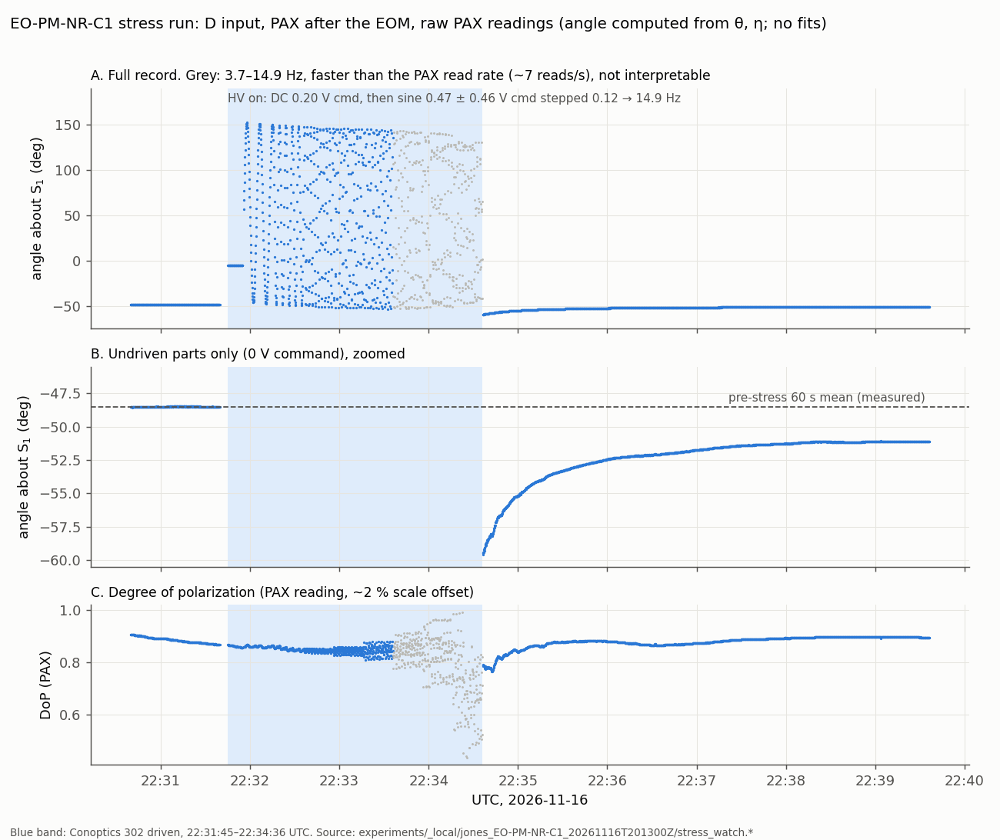
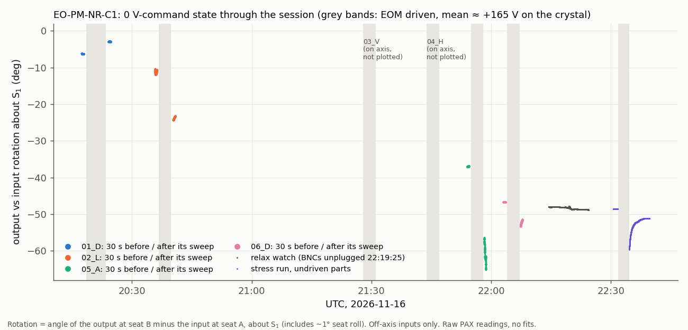
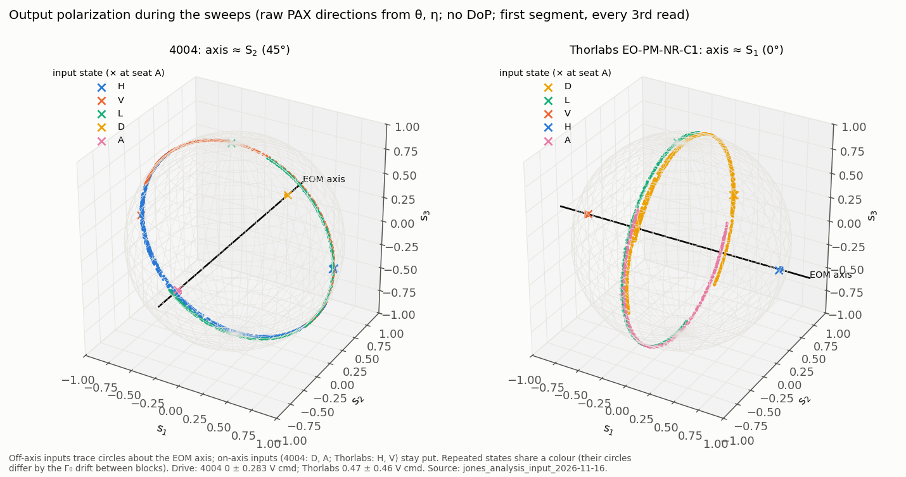
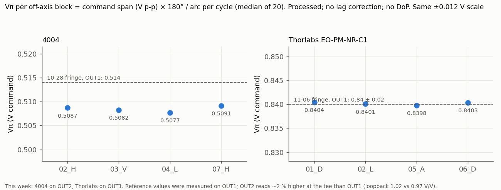
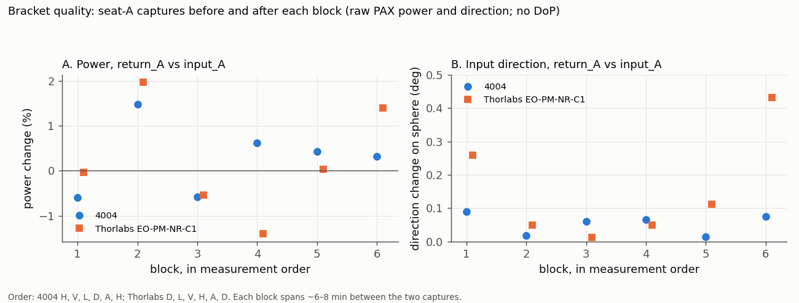
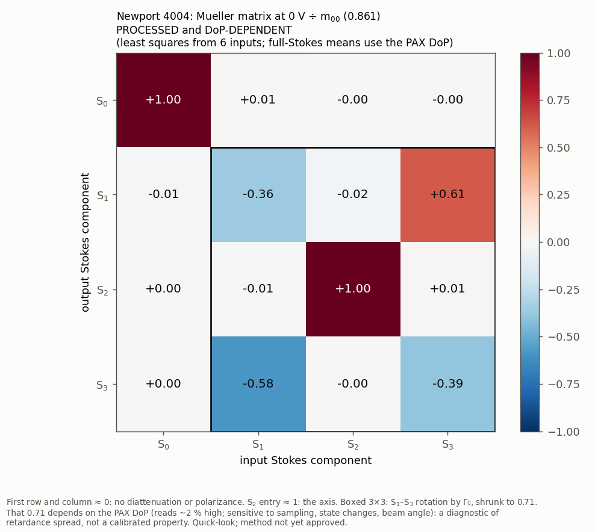

# 2026-11-16 (with 11-14) — EOM polarization transfer, campaign (a): Newport 4004 and Thorlabs EO-PM-NR-C1

**First Jones/Mueller campaign.** For each EOM: the PAX measures a known input state at seat A (EOM input position), then
the output at seat B (after the EOM) undriven and during a slow sine drive, one block per input state. Goal: per-EOM
M(V) for a polarimeter simulation. Nothing here is reconstructed; numbers below are **quick-look, check-only**
(processed from raw records by agent scripts; methods not yet approved in a Decisions table) until the analysis
notebook reproduces them.

**Notebook:** `notebooks/Tutorial-EOM_Jones_matrix_measurement.ipynb` (plumbing `python/eom_jones/`, 15 tests with fakes).
**Data (single analysis copy):** `../jones_analysis_input_2026-11-16/` (README: what it is and is not; MANIFEST.sha256).
Originals still in `experiments/_local/` (operator: keep for now). The package, the operator-notes copies and the raw data are local only (git-ignored), so those links work only on this machine; no backup yet.

**Bench:** 830 nm ECDL; PSG (PBS, HWP, QWP); PAX1000IR1 (mode 5, ~145 ms/read) on repeatable seats A and B, straight
path, only the EOM between. Newport 4004: RP OUT2 → tee (IN2) → preamp → New Focus 3211, TEC 10.75 set / 10.07 read,
driver off for undriven captures. EO-PM-NR-C1: RP OUT1 → tee (IN1) → Conoptics 302 (bias unchanged), TEC 11.70 /
11.63, 302 left on at 0 V command for undriven captures (≈ +1.3 V from the 302). RP loopback check 11-16 (drivers off):
OUT1 → IN1 0.97 V/V (zero −5.4 mV), OUT2 → IN2 1.02 V/V, crosstalk < 0.3 mV.

## EOM fact sheet (quick-look, check-only)

| | Newport 4004 (repaired) | Thorlabs EO-PM-NR-C1 |
|---|---|---|
| Drive this week | RP OUT2 → preamp → 3211; 0 ± 0.283 V cmd (no DC part) | RP OUT1 → 302; 0.47 ± 0.46 V cmd (≈ +165 V DC part) |
| Axis (PAX frame) | ≈ S₂, 45° · raw | ≈ S₁, 0° · raw |
| Vπ (command) | 0.508–0.509 V · processed (10-28 on OUT1: 0.514) | 0.840 V · processed (11-06 on OUT1: 0.84 ± 0.02) |
| Transmission m₀₀ | 0.86 · processed, DoP-free (power ratio B/A) | ≈ 0.97 (B/A power at 0 V) · raw |
| Diattenuation / polarizance | ≤ 0.01 · processed | not computed |
| Γ₀ over the session | −122° → −125° (≈ 1 h 20 min) · processed | −6° → −50°, history-dependent · processed |
| Off-axis DoP at B, rested | 0.68–0.72 · **PAX DoP, caveat** | 0.97–0.98 (down to 0.31 after driving) · **PAX DoP, caveat** |
| On-axis DoP at B | 1.00–1.02 · PAX DoP | ≈ 1.01 · PAX DoP |
| A→B blank difference | 0.6° (H input) | 0.2° (D input) |
| Valid for | this mounting (floating roll), 0 ± 0.28 V cmd, ≤ 0.23 Hz | 0.01–0.93 V cmd, ≤ 1.9 Hz; Γ₀ depends on drive history |

## Findings (quick-look, check-only)

| # | Quantity | Value | Category | Source |
|---|---|---|---|---|
| 1 | 4004 axis | ≈ S₂ (±45° in PAX frame); D, A pass unchanged (DoP 0.998 / 1.015 at B) | raw | 4004 05_D, 06_A |
| 2 | 4004 Vπ | 0.508–0.509 V command (arc 199.8–200.4° per cycle for 0.5652 V p-p; 10-28: 0.514) | processed (arc ratio, no lag) | 02_H, 03_V, 04_L, 07_H |
| 3 | 4004 M(0) | retarder about S₂: m₀₀ 0.861, m₂₂/m₀₀ 0.996, \|D\|,\|P\| ≤ 0.01, Γ₀ ≈ −121° (sign per convention), rotation block shrunk to 0.71 | processed (least squares, 6 inputs, cond 2.9, resid 0.007; outputs ÷ mean S₀ of input_A and return_A) | all 4004 blocks |
| 4 | 4004 consistency | D+A vs H+V at 0 V (outputs ÷ mean input S₀): S₀ 1.718 vs 1.725; S₁–S₃ within 0.035 | processed | same |
| 5 | 4004 off-axis DoP at B | pre-sweep baselines 0.68–0.72 (H, V, L), driver off; post-sweep 0.65–0.71 (03_V wanders 0.63–0.68); input DoP 1.00–1.02 | raw (means) | baselines |
| 6 | 4004 Γ₀ drift | H output −121.9° → −124.6° (02_H) → −125.3° (07_H) over ≈ 1 h 20 min | processed (mean direction) | 02_H, 07_H |
| 7 | Thorlabs axis | ≈ S₁ (0°); H, V pass unchanged (DoP ≈ 1.0) | raw | 03_V, 04_H |
| 8 | Thorlabs Vπ | 0.840 V command (arc 197.9–198.0° for 0.9238 V p-p; DC check 0.20 V → +43.3°, predicted 42.9°); unchanged 0.12–1.9 Hz | processed | 01_D…06_D, stress_watch |
| 9 | Thorlabs Γ₀ at 0 V (rotation vs input, about S₁) | before → after each sweep: 01_D −6.2 → −2.9°; 02_L −11.4 → −23.7°; 05_A −37.0 → −60.8°; 06_D −46.7 → −52.3° | processed (mean direction vs input) | blocks |
| 10 | Thorlabs stress run | pre −48.5°; first reading after HV off −59.5° (first 10 s mean −58.2°); 5 min later −51.1° | processed (mean direction) | stress_watch |
| 11 | Thorlabs DoP after driving | 05_A post 0.31 (0.26–0.38); 01_D post 0.81; stress post (first 10 s) 0.79 → 0.90; rested 0.97–0.98 | raw (means) | blocks, stress_watch |
| 12 | Unplug test (Thorlabs, at rest) | no step at shield taps; ≈ 0.35° settle after unplugging (−48.25 → −48.6°); drift −0.04°/min before and after | processed (mean direction, linear slope as a check) | relax_watch |
| 13 | A→B difference from the blank ("seat roll") | 4004 session 0.6° (1.24° on sphere, H input); Thorlabs session 0.2° (0.38°, D input). The two differ; with one input per blank, seat re-seating at B, state-dependent PAX error and beam-angle changes after realignment cannot be separated (next time: H, D, L in one blank) | processed (mean direction) | 08_H, 07_y |
| 14 | RP sine frequency step | 125 MHz / 2³⁰ = 0.1164 Hz; periods 8.590 s, 4.295 s | RP readback | all sweeps |

## How we got there

1. **11-14:** 4004 runs never drove the EOM (OUT1 cabled to the 302, not the 3211; tee flat). Two failed starts
   (PAX port held by an orphaned viewer daemon). Deleted by the operator (2026-11-17); context kept here.
2. **11-16, 4004:** wiring corrected; blocks H, V, L, D, A, H + blank H. Block 01_L (mislabeled H) superseded.
3. **11-16, Thorlabs:** first session driven on OUT2 (= 3211, wrong output; the agent applied a contradicting wiring
   statement without flagging it; the operator caught it on the 3211 monitor). Void; deleted 2026-11-17 (its operator notes are copied here). Second session on OUT1:
   D, L, V, H, A, D + blank D (block labelled "y" by typo). Then an agent-run relax watch with a BNC unplug, and an
   agent-run stress run (HV 22:31:45–22:34:36 UTC), both operator-authorized.

## Physics used

A linear retarder rotates the Poincaré sphere about its axis by $\Gamma(V)=\Gamma_0+\pi V/V_\pi$; its Mueller matrix
is block-diagonal with that 3×3 rotation. A spread of retardance $\sigma$ across rays averages the Mueller matrices:
$\langle\cos\Gamma\rangle=e^{-\sigma^2/2}\cos\bar\Gamma$, so the rotation block shrinks while the axis entry stays 1.
On-axis inputs keep DoP 1; off-axis ones drop. The 4004's 0.71 block corresponds to $\sigma\approx0.83$ rad.
With a sine drive $\Gamma(t)=\Gamma_0+A\sin\omega t$, odd harmonics carry $\sin\Gamma_0$ and even ones $\cos\Gamma_0$
(Jacobi–Anger); a Γ₀ drift moves signal between them, so a demodulated polarimeter's calibration goes stale unless
Γ₀ is tracked or locked.

## Figures

| | |
|---|---|
| Thorlabs stress run: angle about S₁ (raw, from θ, η), undriven zoom, DoP; HV window shaded |  |
| Thorlabs 0 V state through the session (off-axis inputs; drive periods shaded; rotation includes seat roll) |  |
| Sweep arcs on the Poincaré sphere, one sphere per EOM: circles about S₂ (4004) and S₁ (Thorlabs); raw directions, no DoP |  |
| Vπ per off-axis block (processed; no DoP); reference values measured on OUT1 |  |
| Bracket quality: power and direction change between the seat-A captures of each block (raw; no DoP) |  |
| 4004 Mueller matrix at 0 V ÷ m₀₀ — **PROCESSED and DoP-DEPENDENT**: the 0.71 rotation block rests on the PAX DoP |  |

## Findings (calibrated)

1. Both EOMs act as linear retarders with stable Vπ and axis over these sweeps; diattenuation is negligible (4004). The Thorlabs EOM additionally loses DoP for a while after driving (down to 0.31), so its matrix is not fixed in time.
2. The Thorlabs Γ₀ depends on drive history: it moves during and after driving and relaxes over minutes. Consistent
   with charge build-up driven by the 302's DC offset (≈ +165 V mean); unproven. Not affected by unplugging.
3. The 4004 depolarizes off-axis inputs at zero field. Consistent with tilt × beam divergence through a long
   birefringent crystal (alignment); untested. The 4004 mount has a floating roll DOF, so its axis angle holds for
   this mounting only.
4. PAX DoP reads 1.00–1.02 on clean states (≈ 2 % scale offset). Every DoP-dependent number here (rows 3, 5, 11, the 0.71 block) inherits the PAX DoP's sensitivity to sampling, state changes within a revolution, beam angle and calibration; treat them as diagnostics, not properties.

## Decisions status (notebook)

All approved: 1 (30 s captures), 3 (span 1.1 Vπ), 4 (return to A); 2 (display both a DoP-free mean direction and a
DoP-dependent full-Stokes mean, labelled; DoP never folded in silently), 3a (whole-RP-step periods, 20 cycles, two-rate
first sweep), 5 (redo rule: operational faults only), 6 (raw only) — 2, 3a, 5, 6 by TS 2026-11-17. Analysis Decisions (Δt, Γ₀ per block,
seat transform, Jones extraction) belong to the analysis notebook.

## Open items (ranked)

1. Check the preamp + 3211 before any 4004 use (void Thorlabs run drove OUT2 up to 0.935 V command vs the 0.48 V limit).
2. Back up `../jones_analysis_input_2026-11-16/` off-machine.
3. Analysis notebook (next session), starting from the package README.
4. Fixed 4004 mount; realign by maximizing off-axis DoP; re-measure one off-axis and one on-axis block.
5. Thorlabs drift tests: DC hold vs sweep; zero-mean drive via the bipolar 3211.
6. QWP handedness check (sign of S₃); blank L for both EOMs.
7. Wire `eom_jones` tests into `scripts/test-offline.sh`.

## Provenance

Sessions `jones_Newport-4004_20261116T173136Z` and `jones_EO-PM-NR-C1_20261116T201300Z` (each records git rev,
versions, viewer/PAX config text, plumbing source). Operator notes: `operator_notes_*.md` in this folder.
